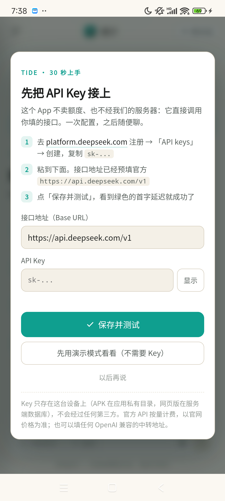
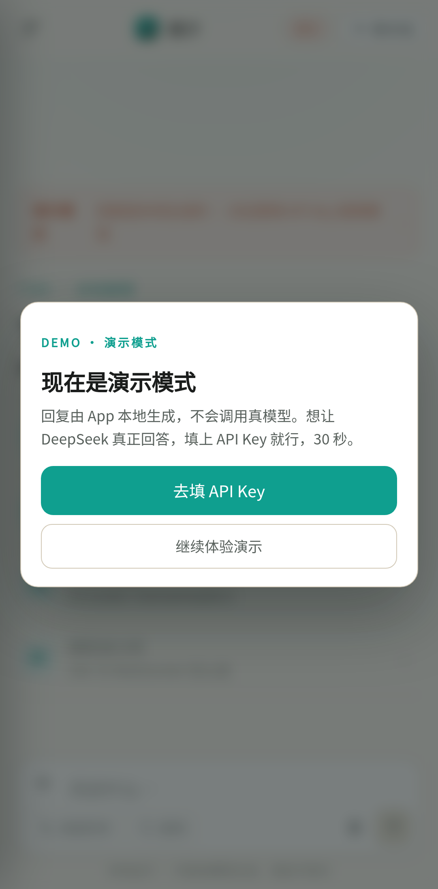
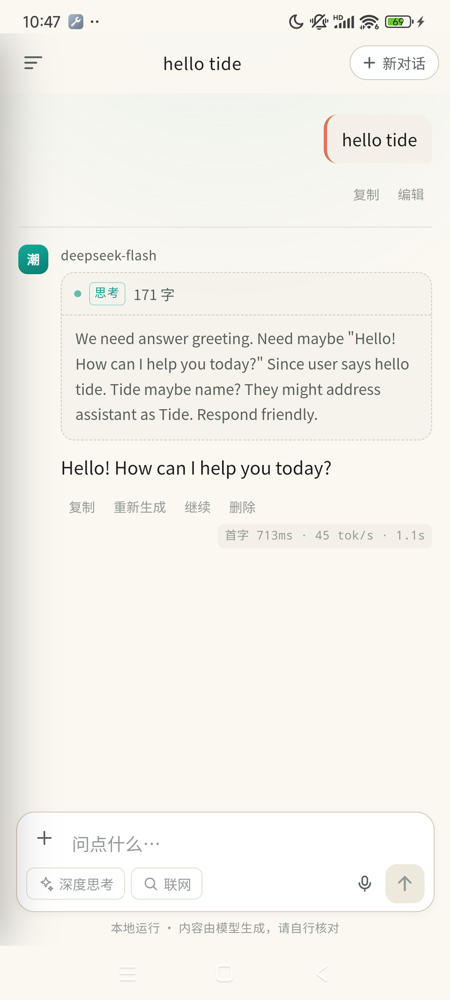

# DeepSeek API 便捷连接

把 DeepSeek API 变成「像官方 App 一样能用」的客户端：**安卓 APK + 网页版**，前后端都在本地，不经过任何第三方服务器。

> 客户端名：**潮汐（TIDE）**　仓库名：**deepseek-api-easy-connect**
>
> 起因：官方 App 调整额度后，不少人转到 API 端继续用，但对着 Base URL / API Key / 模型名这些东西发怵。
> 这个项目把「装上 → 粘 Key → 开聊」做成三步，其余都藏起来。

---

## 特性

**安卓 APK（100KB，自包含）**

- 内置后端（手写 Java HTTP + SSE），**不需要 Node、不需要 root、不需要连电脑**
- 首次启动自动弹配置向导：官方 Base URL 预填、粘 Key、一键测试、绿色首字延迟
- 流式输出、思考过程折叠、停止生成、重新生成、编辑重发
- 会话管理（搜索 / 置顶 / 改名 / 删除 / 导出）
- 文件上下文（docx / txt / md / csv / 代码）
- 联网搜索（Bing RSS，免 Key）
- 深色模式、Markdown、代码高亮、一键复制
- 演示模式：没有 Key 也能先看界面

**网页版（Node，零依赖）**

- 同一份前端，`node server/index.mjs` 就能跑
- OpenAI 兼容网关 `/v1`：可以把这个服务当成 API 端点给别的工具用
- SSE 直通 + 连接池预热，首字延迟只比直连上游多几毫秒

---

## 截图

| 首次引导 | 演示模式提示 | 对话 |
|---|---|---|
|  |  |  |

---

## 快速开始

### 方式一：装 APK（推荐给普通用户）

1. 下载 [`dist/Tide-1.1.0.apk`](dist/Tide-1.1.0.apk)
2. 传到手机安装（自签包，系统会提示"未知来源"，允许一次）
3. 打开「潮汐」→ 粘 API Key → 「保存并测试」→ 开聊

> APK 是自签名的，没有上架任何应用商店；想自己签一份见「构建 APK」。

### 方式二：网页版

```bash
git clone https://github.com/yiiii719/deepseek-api-easy-connect.git
cd deepseek-api-easy-connect
node server/index.mjs
# 浏览器打开 http://127.0.0.1:8899
```

要求 Node 20+（`node:sqlite` 在 22.5+ 更稳；没有时会自动退回 JSON 存储）。

### 拿到 API Key

1. 打开 <https://platform.deepseek.com/api_keys>
2. 创建 API Key，复制 `sk-...`
3. 粘到 App 的引导里即可

官方 API 是**按量计费**的，充多少用多少；也可以填任何 OpenAI 兼容的中转地址（改 Base URL）。

---

## 数据与隐私

- **没有账号、没有埋点、不收集任何数据**
- API Key 只存本机：APK 在应用私有目录 `/data/data/com.tide.chat/files/store/`，网页版在 `data/deepseek.db`
- 对话只存本机，卸载即清空
- 唯一的外发请求：你自己配置的上游 API（以及手动开启的 Bing 搜索）

---

## 架构

```
┌─ WebView / 浏览器
│    └─ web/  原生 ES 模块，无构建、无框架
│         ├─ 流式渲染（0.16ms/帧）
│         ├─ Markdown + 代码高亮（自研）
│         └─ 会话 / 设置 / 引导
└─ 后端（两份实现，接口一致）
     ├─ server/        Node 零依赖：HTTP + SSE + SQLite + 搜索 + 文件解析
     └─ android/java/  Java 手写：ServerSocket + SSE + JSON 存储 + docx 解析
```

## 目录

```
server/      Node 后端（零依赖）
web/         前端（无构建）
android/     APK 工程（Java + 资源 + 构建脚本，无需 Android Studio）
bench/       延迟体检脚本
deploy/      设备端脚本（可选：把 Node 服务跑在安卓上）
docs/        接口手册 / 与官方 App 对照
dist/        预编译 APK
tools/       开发辅助（Markdown 自检、UI 冒烟）
```

---

## 构建

### 网页版

```bash
node server/index.mjs            # 或 pnpm start
node bench/latency.mjs deepseek-flash 5   # 延迟体检（需要 DS_API_KEY）
```

### 构建 APK（不需要 Android Studio）

只需要 JDK 17 + 约 110MB 的 Android 工具链（aapt2 / d8 / apksigner / zipalign / android.jar）。

```powershell
# 1) 拉工具链（脚本只是下载 + 解压，来源是 dl.google.com）
pwsh android/get-tools.ps1

# 2) 生成自己的签名（仓库里不放 keystore）
keytool -genkeypair -keystore android/tide.jks -alias tide -keyalg RSA -keysize 2048 `
        -validity 10000 -storepass tidepass -keypass tidepass -dname "CN=TIDE"

# 3) 构建
cd android
$env:JAVA_HOME="C:\Program Files\Microsoft\jdk-17.0.21.21-hotspot"
node build.mjs        # 输出 Tide-1.1.0.apk
```

构建脚本会把 `web/` 复制进 `android/assets/web/`，然后 `aapt2 → javac → d8 → zipalign → apksigner` 一路走完。
注意 `aapt2 link` 必须带 `-A assets`，否则 APK 里没有前端资源。

---

## 已知限制

- 模型在云端：客户端只是壳，离线不可用（除非自己接端侧小模型）
- APK 内不解析 PDF（docx / txt / csv / 代码可以）
- 自签 APK，不能上架应用商店；升级要保留 keystore，否则签名冲突
- 单机单用户，没有多租户 / 云同步

---

## 免责声明

- 本项目**不是官方项目**，与 DeepSeek 无任何关联；「DeepSeek」仅用于说明所调用的服务
- 使用需遵守上游服务的条款与计费规则
- APK 为自行签名构建，安装与使用风险自负

## License

[MIT](LICENSE)
